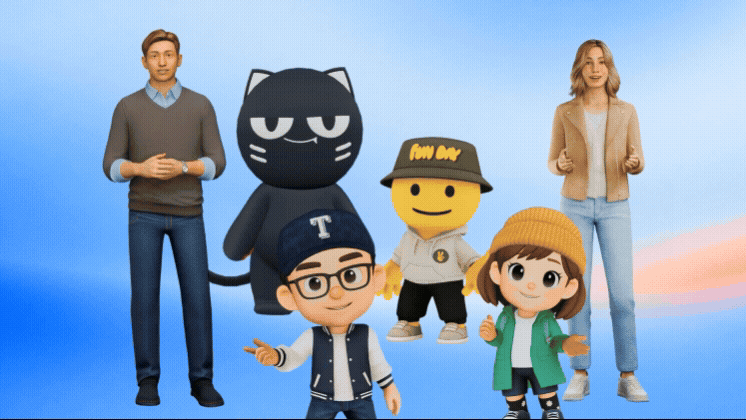
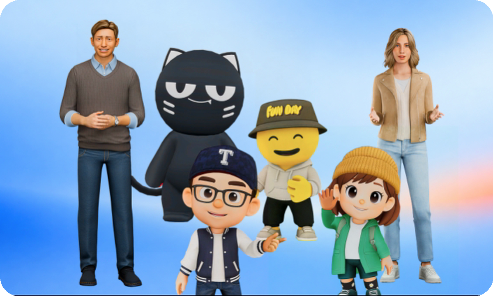
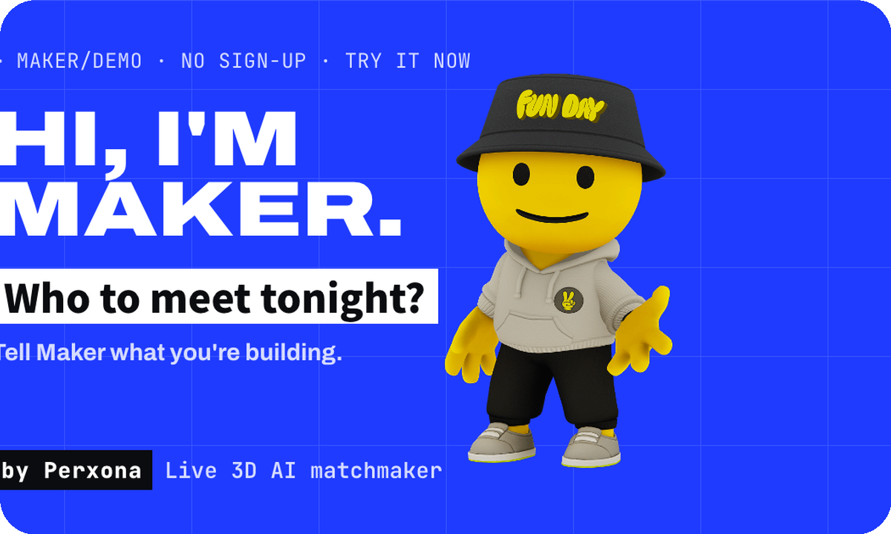

<!-- markdownlint-disable MD033 MD041 -->

<h1 align="center">
  <picture>
    <source media="(prefers-color-scheme: dark)" srcset="docs/assets/perxona-logo-dark.png">
    
  </picture>
</h1>

<p align="center">
  <a href="https://github.com/XRSPACE-Inc/perxona-connect-kit/releases">
    
  </a>
  <a href="https://www.npmjs.com/package/@perxona/presenter-types">
    
  </a>
  <a href="LICENSE"></a>
  <a href="https://connect.perxona.ai"></a>
  <a href="https://github.com/XRSPACE-Inc/perxona-connect-kit/discussions">
    
  </a>
  <a href="https://deepwiki.com/XRSPACE-Inc/perxona-connect-kit">
    
  </a>
  <a href="https://context7.com/xrspace-inc/perxona-connect-kit">
    
  </a>
</p>

<h2 align="center">Give your AI agent a face.</h2>

<p align="center">
  A 3D avatar that speaks your agent's words with lip-sync, emotion and gestures,<br>
  on a website, in a desktop app or inside a browser extension.
</p>

<p align="center">
  
</p>

<p align="center">
  <a href="#build-your-agent-in-5-minutes">
    
  </a>
  &nbsp;
  <a href="https://vercel.com/new/clone?repository-url=https%3A%2F%2Fgithub.com%2FXRSPACE-Inc%2Fperxona-connect-kit&amp;root-directory=samples%2Fexpress&amp;project-name=perxona-connect-kit&amp;repository-name=perxona-connect-kit&amp;env=PERXONA_CONNECT_SECRET_KEY%2CPERXONA_CONNECT_PUBLISHABLE_KEY&amp;envDescription=Two%20Connect%20API%20keys%20from%20the%20Perxona%20Console%3A%20open%20the%20avatar%20menu%20%28top%20right%29%2C%20then%20Management%2C%20Integration%2C%20Connect%20API%20keys.%20Leave%20the%20secret%20key%27s%20domain%20list%20empty.&amp;envLink=https%3A%2F%2Fgithub.com%2FXRSPACE-Inc%2Fperxona-connect-kit%2Fblob%2Fmain%2Fsamples%2Fexpress%2FREADME.md%23getting-a-connect-account&amp;demo-title=Perxona%20Connect%20Kit&amp;demo-description=A%20talking%203D%20AI%20avatar%20with%20lip-sync%20in%20your%20web%20app%2C%20with%20the%20Studio%2C%20Embed%20and%20InterviewCoach%20demos.">
    
  </a>
  &nbsp;
  <a href="https://showcase.perxona.ai">
    
  </a>
</p>

A text box is anonymous. A face is a brand. Perxona Connect Kit is the fastest way to put one on your AI: drop the
`<sv-presenter>` web component into any page, connect it to a Perxona chatbot or to the LLM you already use, and call
`present()`. Your agent now has a face and a voice.

## How it works

<picture>
  <source media="(prefers-color-scheme: dark)" srcset="docs/assets/how-it-works-dark.svg">
  
</picture>

<details>
<summary><b>Under the hood:</b> two keys, one rule</summary>
<br>

<picture>
  <source media="(prefers-color-scheme: dark)" srcset="docs/assets/architecture-dark.svg">
  
</picture>

The **secret** key stays on your server. The browser only ever gets the **publishable** key, and `<sv-presenter>` uses
it to resolve the avatar and synthesize speech directly against the Connect API. Details in the
[auth model](samples/express/README.md#auth-model).

</details>

## Build your agent in 5 minutes

> [!TIP]
> **Not a developer, or no Node on this machine?** Do step 1, then pick **Path A** in step 2. Vercel runs the whole
> sample for you and gives you a public URL. No terminal needed. New to GitHub, `.env` files or AI coding editors?
> The [Vibe Coder Beginner Guide](#vibe-coder-beginner-guide) walks you through it with copy-paste prompts.

### 1 · Get your two keys <sub>~2 min</sub>

1. Sign up at **[console.perxona.ai](https://console.perxona.ai)** (free plan).
2. Open the avatar menu (top right) → **Management → Integration → Connect API keys**.
3. Create one **Secret** key (leave its allowed domains **empty**) and one **Publishable** key.

> [!IMPORTANT]
> Each key is shown **once**. Copy both before you close the dialog.

### 2 · Run it <sub>~1 min</sub>

<table>
<tr>
<th width="50%">Path A · Deploy to Vercel (no setup)</th>
<th width="50%">Path B · Run on your laptop (Node 22+)</th>
</tr>
<tr>
<td valign="top">

Click, paste the two keys, deploy. You get a live `*.vercel.app` URL in about a minute.
The deployed `/api/*` routes are public and act with your secret key, so read
[Deploy to Vercel](samples/express/README.md#deploy-to-vercel) before you share the address.

<a href="https://vercel.com/new/clone?repository-url=https%3A%2F%2Fgithub.com%2FXRSPACE-Inc%2Fperxona-connect-kit&amp;root-directory=samples%2Fexpress&amp;project-name=perxona-connect-kit&amp;repository-name=perxona-connect-kit&amp;env=PERXONA_CONNECT_SECRET_KEY%2CPERXONA_CONNECT_PUBLISHABLE_KEY&amp;envDescription=Two%20Connect%20API%20keys%20from%20the%20Perxona%20Console%3A%20open%20the%20avatar%20menu%20%28top%20right%29%2C%20then%20Management%2C%20Integration%2C%20Connect%20API%20keys.%20Leave%20the%20secret%20key%27s%20domain%20list%20empty.&amp;envLink=https%3A%2F%2Fgithub.com%2FXRSPACE-Inc%2Fperxona-connect-kit%2Fblob%2Fmain%2Fsamples%2Fexpress%2FREADME.md%23getting-a-connect-account&amp;demo-title=Perxona%20Connect%20Kit&amp;demo-description=A%20talking%203D%20AI%20avatar%20with%20lip-sync%20in%20your%20web%20app%2C%20with%20the%20Studio%2C%20Embed%20and%20InterviewCoach%20demos.">
  
</a>

</td>
<td valign="top">

```bash
git clone https://github.com/XRSPACE-Inc/perxona-connect-kit.git
cd perxona-connect-kit/samples/express
cp .env.example .env   # paste your two keys
npm install && npm run dev
```

Open <http://localhost:8083>.

</td>
</tr>
</table>

### 3 · Make it yours <sub>~2 min</sub>

1. Open **Studio**, pick an avatar, scene and voice, then click **Launch Presenter**. Say hi.
2. Still in Studio, create a **chatbot**: give it a name, write its persona in **System Instructions** (_"You are Lisa,
   the friendly front-desk host of…"_), and optionally attach a knowledge file (`.pdf`, `.docx`, `.txt`, `.csv`).
3. Open **Embed**. That is your agent, live on a product page, answering in its own voice.

Pin the exact avatar and chatbot with the `DEMO_FIXED_*` variables
([how](samples/express/README.md#steps)), or skip the Perxona chatbot and bring your own LLM with `LLM_API_KEY`.

## Put it in your own app

The whole integration is one element and three calls. Your server tells the browser which presenter engine to load and
hands it the publishable key (the sample's `GET /api/config` and `GET /api/connect-key` do exactly this).

```html
<sv-presenter></sv-presenter>
<button id="start">Talk to me</button>

<script type="module">
  // Load the engine your server points at (PRESENTER_URL in the sample's .env),
  // so the page always matches your account's region.
  const { presenterUrl } = await fetch("/api/config").then((r) => r.json());
  await import(presenterUrl);

  const presenter = document.querySelector("sv-presenter");

  document.querySelector("#start").onclick = async () => {
    await presenter.resumeAudioPlayback(); // browsers only allow audio after a click
    const { connect_key } = await fetch("/api/connect-key").then((r) =>
      r.json(),
    );
    await presenter.initializeWithConnectKey(connect_key, {
      avatarId: "AVATAR_ID",
      sceneId: "SCENE_ID",
      voiceId: "VOICE_ID", // from the catalog or Studio
    });

    // present() never rejects; check the result instead.
    const result = await presenter.present("Hi! I'm your new AI agent.");
    if (!result.success) console.warn(result.code, result.message);
  };
</script>
```

**Already have an agent?** Keep it. Whatever produces the reply, the avatar only needs the text:

```js
const reply = await yourAgent(userMessage); // OpenAI, Claude, LangChain, your own backend…
await presenter.present(reply);
```

Because it is a web component, the same code runs in Electron, a Chrome extension or a kiosk browser. Start from
[`demos/embed/`](samples/express/public/demos/embed/) (about 170 lines) and see the [SDK reference](docs/en/sdk-reference.md)
for motions, emotions and events.

## Built with Perxona Connect Kit

<table>
<tr>
<td width="33%" valign="top">
<a href="samples/express/public/demos/interview/"></a>
<br><b><a href="samples/express/public/demos/interview/">InterviewCoach</a></b>
<br><sub>Mock job interviews with Mia. Scores each answer and reacts with emotion. EN · 日本語 · 繁中. Built in about 18 minutes.</sub>
</td>
<td width="33%" valign="top">
<a href="samples/maker/README.md"></a>
<br><b><a href="samples/maker/README.md">Maker</a></b>
<br><sub>A 3D event concierge that tells guests who to meet tonight, on their own phone. By Angie Chen.
<a href="https://perxona-maker.onrender.com">Try it live</a>.</sub>
</td>
<td width="33%" valign="top">
<a href="https://github.com/XRSPACE-Inc/perxona-connect-kit/discussions"><picture>
  <source media="(prefers-color-scheme: dark)" srcset="docs/assets/your-agent-card-dark.svg">
  
</picture></a>
<br><b><a href="https://github.com/XRSPACE-Inc/perxona-connect-kit/discussions">Your agent here</a></b>
<br><sub>Shipped something? Post it in Discussions and add the badge below to be featured on the
<a href="https://showcase.perxona.ai">Showcase</a>.</sub>
</td>
</tr>
</table>

**Great fits:** practice and training (interviews, sales drills, language), reception and concierge (hotel, clinic,
store), brand hosts and onboarding guides, and VTuber-style characters from your own `.vrm` file
([VRM uploader](tools/vrm-uploader/README.md)).

## Samples and tools

<!--
  This section is the public index. export-artifact.yml's "Verify indexes match the export tree" step matches every
  ](samples/<name>/) and ](tools/<name>/) link in this file against the export tree, both directions. Keep exactly one
  such link per exported sample or tool here, and link to README.md everywhere else. See .agents/rules/connect.md.
-->

- [`samples/express/`](samples/express/): the Express starter. Studio, Embed and InterviewCoach demos, setup and API
  routes.
- [`tools/vrm-uploader/`](tools/vrm-uploader/): checks your own `.vrm` file and uploads it as an avatar.

## Vibe Coder Beginner Guide

New to GitHub or building with an AI coding editor? Start with the
[Vibe Coder Guide in the Developer Handbook](https://connect.perxona.ai/?lang=en#vibe-coder).
The full tutorial and copy-paste AI prompts are maintained there in English, 繁體中文, and 日本語.

The guide covers:

- What GitHub, cloning, environment variables, and the two API key roles mean in plain language.
- Downloading the project with an AI assistant, editor buttons, or a ZIP file.
- Finding and editing your local `.env` file, with links to the credential and sample setup instructions.
- Customizing your avatar website with AI prompts, including keeping secret credentials out of chat and frontend code.

## Learn more

| Where                                                     | What you'll find                                                                                                                                                         |
| --------------------------------------------------------- | ------------------------------------------------------------------------------------------------------------------------------------------------------------------------ |
| 📘 **[Developer Handbook](https://connect.perxona.ai)**   | The full guide. Also mirrored as Markdown in [English](docs/en/), [日本語](docs/ja/) and [繁體中文](docs/zh-tw/).                                                        |
| 🧪 **[Express sample](samples/express/README.md)**        | Setup, configuration, the Studio and Embed demos, and the API routes.                                                                                                    |
| 🛠️ **[Troubleshooting](#presenter-sdk-integration-faqs)** | [Presenter SDK FAQs](#presenter-sdk-integration-faqs) and [billing errors](#billing-errors) (`1003`, `14005`), below.                                                    |
| 🤖 **For AI coding agents**                               | [`llms.txt`](llms.txt), [`llms-full.txt`](llms-full.txt), [Context7](https://context7.com/xrspace-inc/perxona-connect-kit) and [`AGENTS.md`](samples/express/AGENTS.md). |
| 💳 **[Pricing](https://perxona.ai/pricing)**              | Connect Kit sign-ups start on the Free Plan.                                                                                                                             |

## Built with Perxona?

Add the badge to your README:

[](https://github.com/XRSPACE-Inc/perxona-connect-kit)

```markdown
[](https://github.com/XRSPACE-Inc/perxona-connect-kit)
```

## Presenter SDK Integration FAQs

Common questions when integrating the `<sv-presenter>` Presenter SDK, across any sample in this repo. For
setup/environment issues specific to one sample, see its own README instead.

<details>
<summary><b>Why doesn't the avatar speak after <code>present()</code>?</b></summary>
<br>

`present()` resolves with a `PresentationResult` whose `success`
is `false` — check the status message it surfaces (`code`/`message`) for why (e.g. no target resolved yet, or the
Connect API rejected the presentation request). Also confirm the presenter reached `Ready` first.

</details>

<details>
<summary><b>Why doesn't a motion cued via <code>[MOTION ...]</code> markup in <code>present()</code> play?</b></summary>
<br>

Two common causes: the motion ID isn't
in the target avatar's motion catalog (check `GET /api/v1/connect/assets/avatars/:id/motions` for what it actually
supports); or the cue lands too close to the end of the speech — motion playback stops when its accompanying speech
finishes, so a motion cued near the end of a sentence, or in a very short utterance, may not have enough time to
play. To play a motion on its own, independent of the speech queue, call `presenter.playMotion(motionId)` instead.

</details>

## Billing errors

<details>
<summary><b>A call fails with <code>code: 1003</code> or <code>14005</code></b></summary>
<br>

If your organization's credits are exhausted, **or its subscription itself is no longer active**, metered calls (such as
chatbot chat) fail with the same HTTP `400` and `code: 1003`, with a body like one of these:
`{"code": 1003, "details": "credit_points exhausted for org_id: ..."}` or
`{"code": 1003, "details": "Subscription status is not valid for org_id: ..."}` — the `details` field is what tells the
two apart. A third, separate case — **no subscription record for the org at all** — fails with HTTP `403` and
`{"code": 14005, "details": "No active subscription found for org_id: ..."}` instead. At that point, sign in to
[Perxona Console](https://console.perxona.ai/asia) (use the region matching your account) with your Connect account
credentials (see [`samples/express/README.md`](samples/express/README.md#getting-a-connect-account) for sign-up steps),
open the organization management page, review **Subscription**, then top up credits or upgrade the plan.

</details>

<sub>Licensed under [Apache 2.0](LICENSE).</sub>
